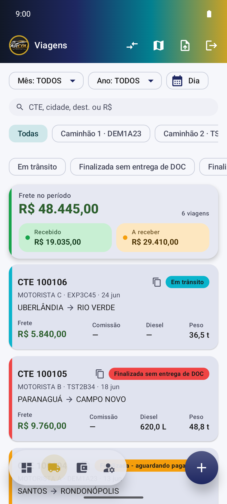
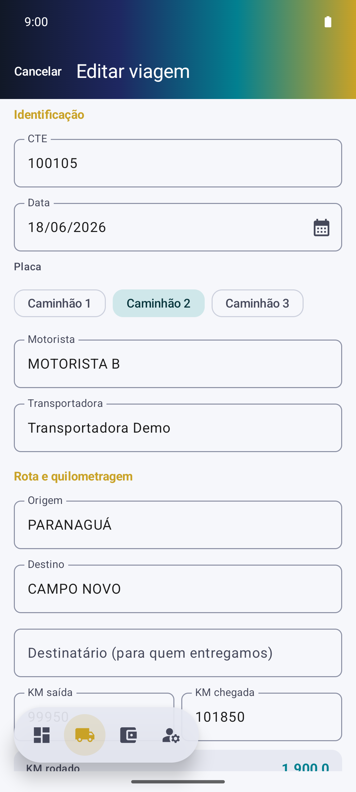
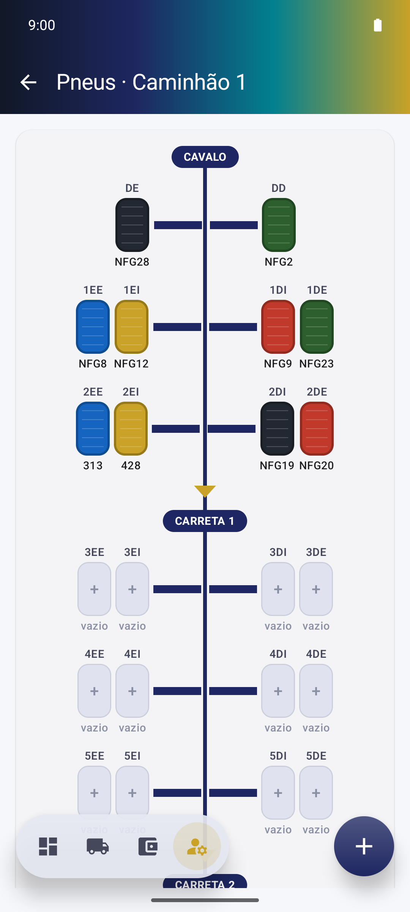
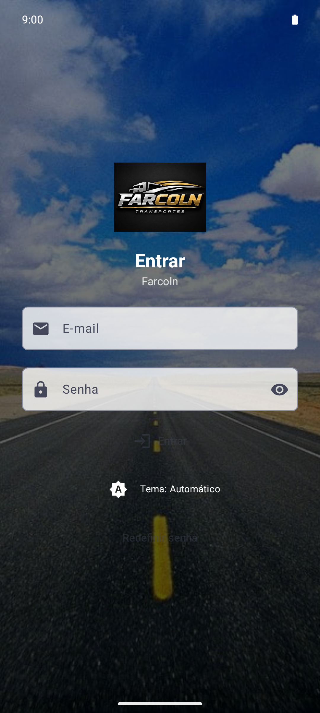

# FARCOLN Frota

App de gestão de frota de uma transportadora cliente: viagens, despesas, caixa e conciliação de carta-frete. Criado por mim em cerca de 10 semanas, com desenvolvimento assistido por IA.

> O código-fonte é privado porque contém dados reais do cliente. Este repositório apresenta o projeto.

## O que o sistema faz
- Controle de viagens, despesas e caixa da frota.
- Leitor de boleto no padrão FEBRABAN e leitor nativo de código de barras.
- Conciliação automática entre documentos de frete e extrato bancário, conferida contra a planilha original por testes.

## Números
- Kotlin Multiplatform com 4 alvos: Android, iOS, Web e Desktop.
- Cerca de 78% do código compartilhado.
- 114 testes automatizados.
- Repositórios por interface com 3 implementações (memória, Firestore e ponte JavaScript na Web).

## Stack
Kotlin Multiplatform · Compose Multiplatform · Koin · Firebase · IA com especificação (SDD e PRD)

## Telas (Android, dados de demonstração)

   

---
**English:** Fleet-management app for a trucking company (trips, expenses, cash, freight reconciliation). Kotlin Multiplatform with 4 targets, ~78% shared code, FEBRABAN bank-slip parser, 114 tests.
